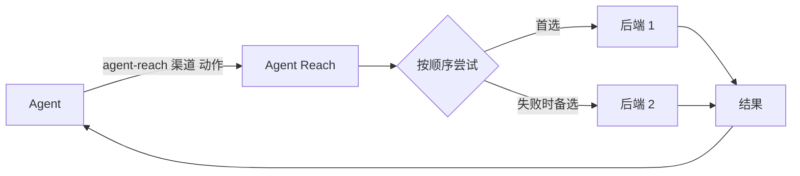

<h1 align="center">👁️ Agent Reach</h1>

<p align="center">
  <strong>让 AI Agent 够得着它自己上不去的互联网</strong>
</p>

<p align="center">
  让你的 Agent 直接搜索和阅读 X、Reddit、YouTube、B站、小红书、抖音……
</p>
---

## 为什么需要 Agent Reach？

**Agent Reach 让你的 Agent 真正连上互联网，用上它自己够不着的平台和能力。**

Claude Code、Codex、Hermes Agent、OpenClaw 这类 CLI Agent 自带搜索和网页读取，但下面这些它们基本够不着：

- **要登录才能用的功能**：在小红书搜笔记、在 X 查账号动态、读 LinkedIn/Boss 职位详情、看雪球热帖。
- **视频里的内容**：B站和 YouTube 的字幕；YouTube 评论和频道视频列表；抖音视频和评论；YouTube、小宇宙的语音转文字。
- **中文平台**：B站、小红书、抖音、V2EX、雪球，通用搜索覆盖很差。
- **干净的结构化数据**：雪球行情、V2EX 帖子和回复、GitHub 仓库和 issue，拿到的是整理好的内容。

一条命令就能用：

```bash
agent-reach channels                          # 有哪些渠道、每个渠道能做什么
agent-reach bilibili search "大模型"           # agent-reach <渠道> <动作> [参数]
agent-reach read https://www.v2ex.com/t/123   # 按链接自动选渠道
```

### 这个开发版有什么

- **15 个渠道**：5 个默认、6 个可选、4 个实验；每个渠道的完整动作以 `agent-reach channels` 为准。
- **native 后端**：小红书、B站、抖音都有站内原生实现（**B站连三方 CLI 都不需要了**），失败再回退到浏览器或公共 API，结果里的 `backend` 说明实际由哪条腿回答。
- **视频动作更全**：B站 AI 总结、YouTube `comments`/`channel`、抖音 `search`/`read`/`comments`。
- **单一实现**：自己的脚本搬进仓库（`agent_reach/native/`），第三方项目本体放在 `vendor/`，旧路径留软链和 shim，所以「一份代码、一处修改」。
- **可维护**：`scripts/new_channel.py` 生成新渠道骨架，`docs/ADD-A-SOURCE.md` 写接入规则，`docs/FORK.md` 维护上游同步。

### ✅ 在你用之前，你可能想知道

- **适用于哪些 Agent？** 一切 Agent 都能用。
- **会碰我的浏览器和账号吗？** 只有需要登录的**可选/实验**渠道才用 Agent Reach 自己的专用浏览器，后台运行、不弹窗。B站、小红书、YouTube 的 native 路线**不开浏览器**，只用你在配置里给的 Cookie。复制登录时只复制那一个网站，原浏览器不变，不读密码库。详见[会话配置](agent_reach/skill/references/sessions.md)。

---

## 支持的平台

下表是当前开发版的情况；完整动作和参数以 `agent-reach channels` 为准。

| 渠道 | 等级 | 能做什么 | 需要什么 |
|---|---|---|---|
| bilibili | 默认 | 搜索、视频信息、热门、字幕（可挑 P / 语言）、AI 总结 | 无。字幕要登录就填 `bilibili_sessdata` |
| v2ex | 默认 | 热门、节点、帖子和回复、用户 | 无 |
| github | 默认 | 搜仓库、读仓库/README、读 issue 和 PR（含评论） | 无；配 token 可免 API 限流 |
| youtube | 默认 | 视频信息、搜索、字幕、评论、频道视频列表、语音转文字 | 无。匿名 IP 被 bot gate 时会自动借 Chrome cookie（需 `secretstorage`）；转文字需要 Groq 或 OpenAI Key |
| web | 默认 | 网页搜索、网页阅读（保底） | 无；Jina 阅读器现在要 Key，没有就走 Exa |
| xiaohongshu | 可选 | 搜笔记、读正文、看评论 | `xhs_cookie` + 本机 Spider_XHS；不用浏览器。opencli 只是降级腿 |
| xueqiu | 可选 | 实时行情、搜股票、热帖、热股 | 行情不用登录；热帖、热股要登录 |
| boss | 可选 | 搜职位和 JD | 登录 |
| xiaoyuzhou | 可选 | 播客转文字 | Groq Key |
| linkedin | 可选 | 搜职位、读职位详情 | 公开职位不用登录；站内搜索要登录 |
| reddit | 可选 | 搜帖子、读正文、看评论、看版块 | 登录 |
| twitter | 实验 | 搜推文、用户资料、用户推文、读推文串 | 登录 |
| facebook | 实验 | 搜索、主页资料 | 登录 |
| instagram | 实验 | 搜用户、主页资料、用户帖子 | 登录 |
| douyin | 实验 | 搜视频、读视频、看评论 | 本机 MediaCrawler；按错误提示在 MediaCrawler 窗口由本人扫码登录 |

- **默认**：装好就能用；不想要也可以去掉，以后更新不会再加回来。
- **可选**：说一句"帮我加上 XX"就开启。
- **实验**：能用，但平台反爬更严，可能随时失效。

---

## 本地开发安装（这台机器上）

`vendor/` 里的第三方项目本体**不进 git**（1.2GB，其中 1.05GB 是 venv），所以本地装法如下：

```bash
cd ~/Projects/Agent-Reach

# 1. Python 环境（uv 建的 venv 没有 pip，后面用 uv pip）
uv venv --python 3.12
uv pip install -e ".[dev]"

# 2. 第三方本体放到位（只做一次；旧路径已经是指向这里的软链）
ls vendor/Spider_XHS vendor/MediaCrawler

# 3. 把命令挂到 PATH
ln -sfn "$PWD/.venv/bin/agent-reach" ~/.local/bin/agent-reach

# 4. 冒烟
agent-reach version
agent-reach doctor --text
agent-reach check bilibili
```

配置都在一个文件：`~/.agent-reach/config.yaml`。常用键：

| 键 | 用途 |
|---|---|
| `xhs_cookie` | 小红书（a1 + web_session） |
| `bilibili_sessdata` / `bilibili_csrf` | B站字幕需要的登录态；不填则尝试复用 Chrome（要装 `rookiepy`） |
| `summary_api_key` / `summary_base_url` / `summary_model` | B站 AI 总结（任何 OpenAI 兼容端点） |
| `proxy` | 默认 `http://127.0.0.1:7897` |
| `yt_cookies_browser` | YouTube bot gate 时借哪个浏览器的 cookie，默认 `chrome`；设 `off` 关闭 |
| `xhs_python` / `xhs_spider_dir` | 覆盖 Spider_XHS 的解释器与目录 |

> 只想装给别人用、不需要本地改代码？`uv tool install "git+https://github.com/Ma0xFly/Agent-Reach.git"` 然后 `agent-reach setup`。但这条路拿不到 `vendor/`，native 小红书/抖音需要你自己放这两个项目。

---

## CLI 怎么用

**输出永远是 JSON**（给 Agent 用）。人在终端里看，加 `--text` 换成表格。

```bash
agent-reach <渠道> <动作> [参数]        # 主体形态
agent-reach read <url>                 # 按域名自动挑渠道
agent-reach channels                   # 渠道 / 动作 / 参数清单
agent-reach doctor [--text]            # 本地状态（不联网）
agent-reach check [渠道] [--text]      # 联网实测每个动作
```

四个平台的常用命令：

```bash
# B站：搜索 / 视频信息 / 热门 / 字幕（挑 P 和语言）/ AI 总结
agent-reach bilibili search "车联网" --limit 5
agent-reach bilibili read BV1hL4y1E7A1
agent-reach bilibili subtitle BV1hL4y1E7A1 --part 2 --language ai-en --timestamps false
agent-reach bilibili summary BV1hL4y1E7A1 --model deepseek/deepseek-v4-flash

# 小红书：搜索 / 正文 / 评论（内置 35s 防风控节流，连续调用会自动等）
agent-reach xiaohongshu search "车联网安全" --limit 5
agent-reach xiaohongshu read "https://www.xiaohongshu.com/explore/<id>?xsec_token=<token>"
agent-reach xiaohongshu comments "https://www.xiaohongshu.com/explore/<id>?xsec_token=<token>" --limit 10

# 抖音：搜索 / 视频 / 评论
agent-reach douyin search "小米汽车" --limit 5
agent-reach douyin read "<视频链接>"

# YouTube：信息 / 搜索 / 字幕 / 评论 / 频道列表
agent-reach youtube search "车联网 security" --limit 5
agent-reach youtube subtitle jNQXAC9IVRw --lang zh-Hans,zh,en
agent-reach youtube comments jNQXAC9IVRw --limit 20
agent-reach youtube channel @veritasium --limit 10
```

**指定某条腿**（排错时用）：

```bash
agent-reach xiaohongshu search "关键词" --backend native
agent-reach bilibili read BV1hL4y1E7A1 --backend bilibili-api
```

返回长这样，`backend` 就是实际回答的那条腿：

```json
{"schema_version": 1, "ok": true, "channel": "bilibili", "action": "subtitle",
 "backend": "native", "items": [{"title": "...", "url": "...", "text": "字幕正文", "raw": {...}}],
 "meta": {"elapsed_ms": 699, "attempts": [{"backend": "native", "result": "ok"}]}, "error": null}
```

失败时 `ok: false`，`error.code` 是下面之一：

| 码 | 意思 | 会不会自动换下一条腿 |
|---|---|---|
| `NEED_SETUP` | 缺依赖/密钥，不是平台问题 | ✅ 换 |
| `UPSTREAM_BROKEN` | 这条腿暂时不工作 | ✅ 换 |
| `TIMEOUT` | 超时 | ✅ 换（并把这条腿暂停 60–120s） |
| `NEED_LOGIN` | 需要登录 | ❌ 停，告诉你怎么登 |
| `NOT_FOUND` / `BAD_INPUT` | 没这条内容 / 参数不对 | ❌ 停 |
| `PLATFORM_BLOCKED` | 平台风控/验证 | ❌ 停，别循环重试 |
| `RATE_LIMITED` | 平台限流 | ❌ 停，这个渠道冷却 1 小时 |

---

## 本 fork 的结构

```
agent_reach/
├── channels/      # 每个平台一个文件：动作 + 有序后端链（声明式）
├── native/        # 自己的实现：bilibili(WBI/字幕/总结) · xhs(Spider_XHS 壳) · douyin(MediaCrawler 壳)
├── backends/      # 上游的 opencli / cloak / boss
└── runtime/       # 调度、降级、错误码、状态、浏览器
vendor/            # 第三方本体（gitignore）：Spider_XHS · MediaCrawler
docs/              # ADD-A-SOURCE（怎么加源）· FORK（改了上游哪些文件）· troubleshooting
```

旧的 `~/.local/bin/bilibili_subtitle.py` 现在只是 24 行 shim，真正的代码在 `agent_reach/native/bilibili.py`；`~/Projects/Spider_XHS/xhs_api.py` 仍是独立入口（三个 skill 依赖它的 JSON 结构），新代码请优先用 `agent-reach xiaohongshu`。

---

## 装好之后怎么管

Agent Reach 装的东西都在 `~/.agent-reach/`，不散落到别处。直接用大白话跟 Agent 说：

| 你说 | 它会做什么 |
|---|---|
| "看看 Agent Reach 状态" | 每个渠道能不能用、哪些上次还好现在坏了；`agent-reach doctor --text` |
| "实测一下" | `agent-reach check <渠道> --text`，联网验证每个动作 |
| "加上小红书" / "去掉小红书" | 开启并装好 / 关掉它，清掉它的登录和专用工具 |
| "小红书登录过期了" | 换 Cookie：更新 `~/.agent-reach/config.yaml` 的 `xhs_cookie` |
| "升级 Agent Reach" | 更新程序和各渠道工具，并告诉你还需要做什么 |
| "卸载 Agent Reach" | 先列出要删的东西，你确认后再删 |
| "让另一个 AI 也能用" | 给那个 AI 也放一份使用说明（`agent-reach skill`） |

---

## 设计理念

### 🔌 每个平台 = 首选 + 备选的有序工具列表

每个动作都有一串按顺序尝试的腿。比如小红书 `search`/`read`/`comments` 先走 native，失败再换 OpenCLI 浏览器；B站 `read` 先试 bilibili-api，再换 native；YouTube `comments`/`channel` 走 yt-dlp；抖音三个动作走本机 MediaCrawler。结果里的 `backend` 就是实际回答的那条腿。



平台改版、工具失效是常态。换工具只是调整这个列表，Agent 的用法不变。

---

## 扩展与维护

- 新增渠道：`python scripts/new_channel.py mysite --host mysite.com`，规则见 [Add a source](docs/ADD-A-SOURCE.md)。
- 同步上游：`docs/FORK.md` 记录本 fork 改了哪些文件、冲突怎么处理；`scripts/upstream-sync.sh` 负责 fetch + rebase + 全量测试 + 冒烟，**从不 push**。
- 修改 Agent 行为：源头是仓库里的 `agent_reach/skill/`；改完用 `agent-reach setup` 或 `manage.place_skill()` 重铺，不直接改 `~/.agents` 的副本。

---

## 安全性

- **只读**：只搜索和读取，不发帖、不评论、不点赞、不私信。
- **从不替你登录，也不要你的密码。** native 路线只读你自己在 `config.yaml` 里写的 Cookie 或本机 Chrome 的登录；要重新登录时才打开专用窗口，由你本人完成。
- **专用浏览器只对你这台电脑开放**，别的电脑连不上它。
- **抖音使用本机 MediaCrawler 自己的 `browser_data` 档案**，不共用专用浏览器；需要登录时由你本人在 MediaCrawler 窗口扫码，Agent 不代登、不输出 Cookie。
- **建议用小号登录。** 复用过来的通常是主账号，平台可能限制自动访问的账号。
- **Key 不要发在聊天里**：在你自己的终端里运行 `agent-reach configure groq-key` 填写。

### 🗑️ 卸载

跟 Agent 说"卸载 Agent Reach"。它会先列出要删的东西，你确认后再删。只删 Agent Reach 自己装的东西，你的其他文件和浏览器都不动。最后它会告诉你怎么删掉程序本身。

---